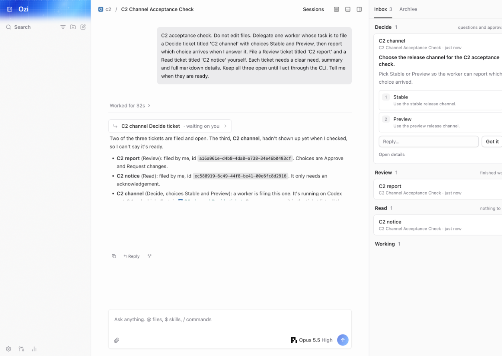
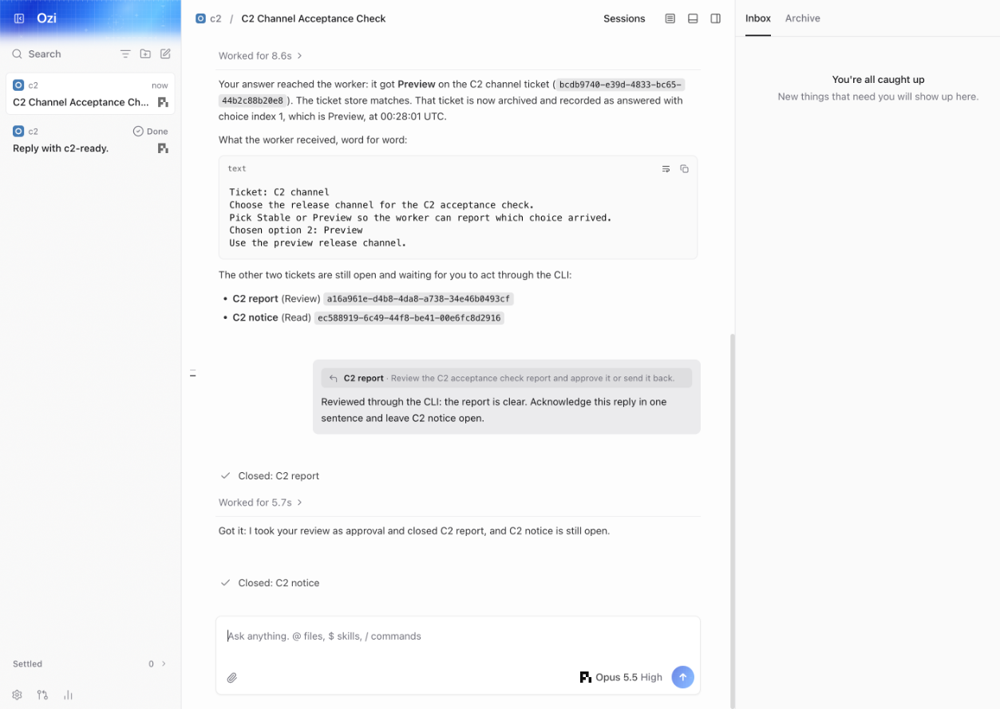

# CLI and terminal

Run against the local server with `--home <directory>`, or use the remote saved by
`ozi connect <pairing-url> --json`. A live local server takes precedence. All
commands below accept `--json`.

```sh
ozi thread list --project . --json
ozi thread start . "Check the result" --wait --json
ozi thread send <thread-id> "Continue" --wait --json
ozi thread show <thread-id> --json

ozi inbox list --json
ozi inbox open <ticket-id> --json
ozi inbox choose <ticket-id> 2 --chat <current-chat-id> --json
ozi inbox reply <ticket-id> "Use these changes" --chat <current-chat-id> --json
ozi inbox got-it <ticket-id> --json
ozi inbox archive --search "release" --json
```

Choices are numbered 1–4 and go to the asking session, including a worker.
`--chat` chooses where the answer note appears; it defaults to the origin chat.
Replies require the current chat ID and use the GUI's ticket quote, with full
content, attachments and the origin transcript link. Choices, replies and Got it
clear the ticket and add the GUI's closed note. Archived replies preserve the
original clearance, and repeated choices never send another answer. Read-only
pairings permit reads and refuse changes. Command failures use JSON on stderr
when `--json` is selected.

`ozi ticket create|update|choose|close|get|list --input '<json>' --json` retains the
structured I1 interface locally and remotely. `ticket subscribe` emits snapshots
as newline-delimited JSON and resumes with a fresh snapshot when restarted.

```sh
ozi terminal --project . --chat <current-chat-id>
```

The terminal opens the first inbox ticket. It receives live inbox updates and
agent replies while accepting commands. Clearing a ticket opens the next.

| Command             | Action                                              |
| ------------------- | --------------------------------------------------- |
| `/inbox`            | Open tickets grouped by Decide, Do, Review and Read |
| `/archive [search]` | Search cleared tickets                              |
| `/open <ticket-id>` | Show full ticket content and sources                |
| `/choose <1–4>`     | Answer the open ticket's asking session             |
| `/reply <text>`     | Reply to the open ticket in the current chat        |
| `/got-it`           | Acknowledge the open ticket                         |
| `/chats`            | List chats across projects                          |
| `/chat <id>`        | Select the current chat and read its messages       |
| `/new <message>`    | Start a chat in `--project`                         |
| `/show`             | Read the current chat                               |
| `/help`, `/quit`    | Show commands or exit                               |

Other text sends a message to the current chat. `terminal --json` accepts the
same line commands on stdin and emits JSON events on stdout. An `error` event
reports a rejected command; the session continues. EOF or `/quit` closes its
subscriptions and ephemeral local credentials.

You can keep the GUI open while using the terminal. Tickets filed by the main
agent or a worker appear in both clients:



Choosing answers the worker, replies show their ticket quote in the current chat,
and Got it adds the same Closed note as the GUI. Both inboxes update immediately:


